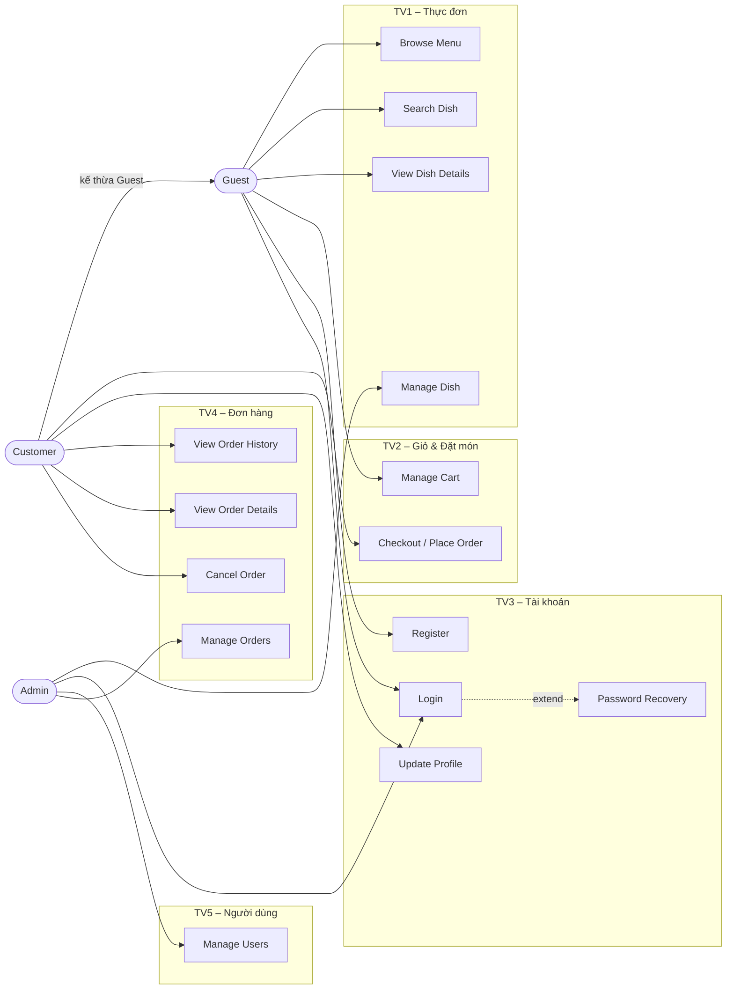
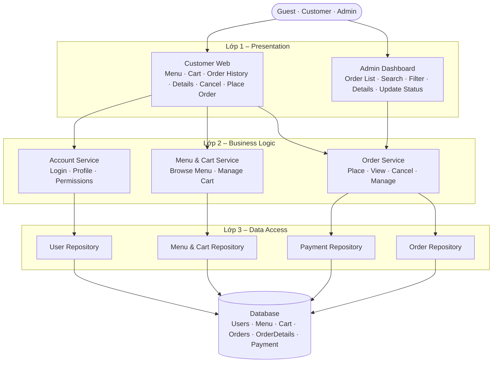
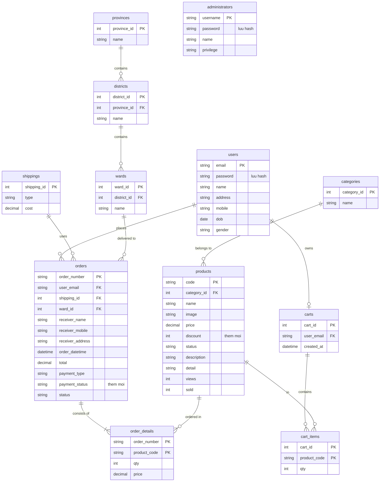
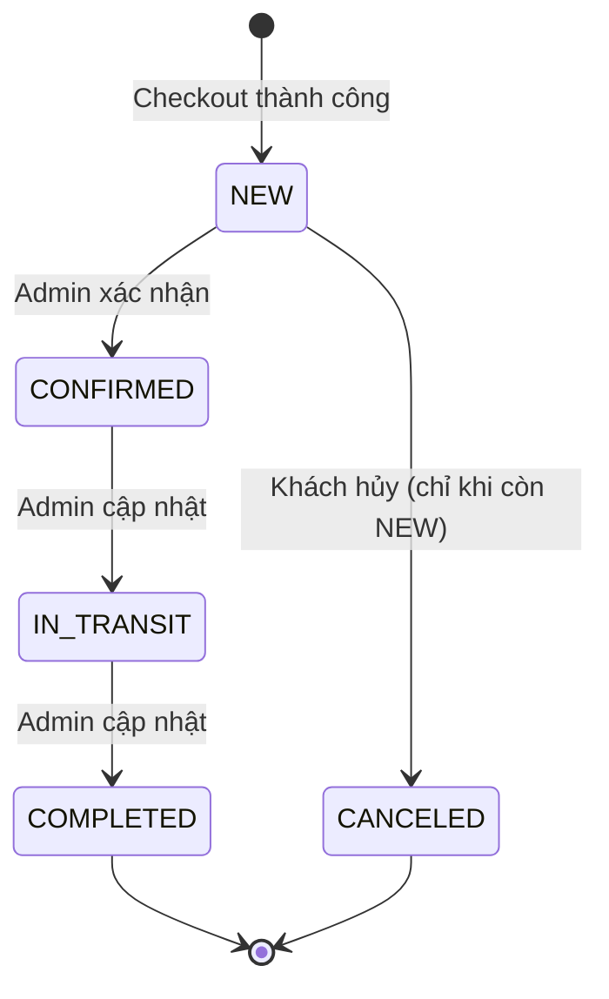
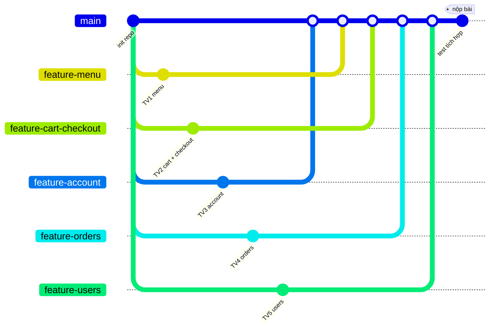

# Restaurant Order Management System – Group 11

Hệ thống đặt món cho nhà hàng: khách xem/tìm thực đơn, thêm món vào giỏ, đặt món, theo dõi đơn; admin quản lý món, người dùng và đơn hàng.

Công nghệ theo đặc tả: HTML, CSS, JS, PHP, MySQL. Đóng gói bằng Docker.

> Các sơ đồ dưới đây viết bằng Mermaid, GitHub tự hiển thị. Sơ đồ gốc (use-case, lớp, ERD, DFD, kiến trúc) nằm trong `docs/Restaurant_System_Specification_v1_2_edited.docx`.

## Thành viên và phân công

| TV | Họ tên | Module | Use-case |
|---|---|---|---|
| TV1 | _điền tên_ | Thực đơn | Browse Menu, Search Dish, View Dish Details, Manage Dish |
| TV2 | _điền tên_ | Giỏ & Đặt món | Manage Cart, Checkout / Place Order |
| TV3 | _điền tên_ | Tài khoản | Register, Login, Update Profile, Password Recovery |
| TV4 | _điền tên_ | Đơn hàng | View Order History, View Order Details, Cancel Order, Manage Orders (admin) |
| TV5 | _điền tên_ | Người dùng & Hạ tầng | Manage Users, repo, CSDL, Docker, đóng gói nộp bài |

Chi tiết từng đầu việc: `docs/Phan_Cong_Nhiem_Vu_Group11.xlsx`. Quy ước chung: `docs/CONVENTIONS.md`.

## Cách chạy

```bash
docker compose up --build
```

Mở http://localhost:8080. CSDL tự tạo từ `database/schema.sql` và `database/seed.sql` ở lần chạy đầu. Muốn tạo lại CSDL từ đầu: `docker compose down -v` rồi chạy lại lệnh trên.

File Docker là bản mẫu cho PHP + MySQL. Nếu nhóm đổi ngôn ngữ thì TV5 sửa `docker/Dockerfile`.

## Sơ đồ

### 1. Use-case theo người phụ trách



### 2. Kiến trúc 3 lớp



### 3. Cơ sở dữ liệu (ERD)

Theo ERD của nhóm, đổi tên bảng sang số nhiều (xem `docs/CONVENTIONS.md`), có thêm `products.discount` và `orders.payment_status`.



### 4. Trạng thái đơn hàng



### 5. Quy trình Git



## Cấu trúc thư mục

```
ProgAndTest_Group11/
├── src/
│   ├── presentation/        # trang, controller (customer/, admin/)
│   ├── services/            # AccountService, MenuCartService, OrderService
│   ├── repositories/        # UserRepository, MenuCartRepository, OrderRepository
│   ├── models/              # User, Product, Category, Cart, Order, OrderDetail, ...
│   └── common/              # kết nối CSDL, tính giá sau giảm, session
├── tests/
│   ├── unit/                # unit test
│   └── Testing_Document.xlsx
├── database/                # schema.sql, seed.sql
├── docker/                  # Dockerfile
├── docker-compose.yml
├── docs/                    # đặc tả, quy ước, bảng phân công
├── evidence/                # bằng chứng dùng công cụ và phân công
│   ├── commits/
│   ├── tool-usage/
│   └── task-assignment/
└── .github/                 # mẫu Pull Request và báo lỗi
```
